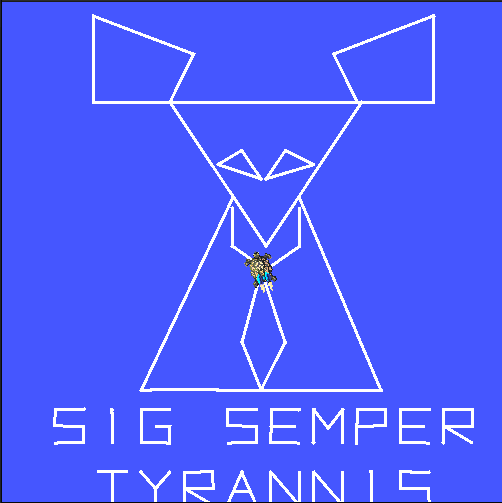
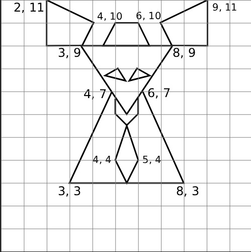

# SIG SEMPER TYRANNIS
"Thus always I bring **death to tyrants**."

## Description
Program dengan nama "Sig Semper Tyrannis" adalah program turtlesim ROS2 yang akan membuat gambar berikut pada turtlesim:



## Penjelasan
### 1. Plotting dan Sketching

Konten di plot di canvas 500x500px dengan grid 11x11 sesuai koordinat satuan turtlesim.

Original plan:


### 2. Package and Node Configuration

Dibuat package dengan python menggunakan:
```
ros2 pkg create --build-type ament_python sig_semper_tyrannis --dependencies rclpy
``` 

Kemudian tambahkan 
```
"sig_semper_tyrannis = sig_semper_tyrannis:main",
```

pada setup.py package

### 3. Code

#### A. Cara kerja sistem koordinat dan gambar:
Sistem menggunakan titik, garis, dan bentuk. Titik menggunakan dtype dictionary dan adalah unit terkecil. Dua titik membentuk suatu garis, dan banyak garis menghasilkan satu bentuk dalam dtype list. Semua koordinat titik diatur dalam variabel `STROKES`.

Ex:
```
[(3.5, 9.0), (7.5, 9.0), (5.5, 6.0), (3.5, 9.0)]
```

#### B. Wrap dan Clamp
Simpelnya, **Wrap** menjaga sudut agar tetap di range normal/masuk akal yakni $-\pi$ dan $\pi$. 

```
def wrap(angle):
    return math.atan2(math.sin(angle), math.cos(angle))
```
Sementara **Clamp** membatasi sebuah nilai `val` berada diantara `minval` dan `maxval` guna mengirimkan kecepatan yang proporsional.
```
def clamp(val, minval, maxval):
    return max(minval, min(maxval, val))
```

#### C. Properti dan Method
Dalam class TurtleArt adalah beberapa properti yang membantu _flow_ dari program:

- Milik turtlesim
```
self.cmd_pub = self.create_publisher(Twist, "/turtle1/cmd_vel", 10)
self.create_subscription(Pose, "/turtle1/pose", self.on_pose, 10)
self.pen_client = self.create_client(SetPen, "/turtle1/set_pen")
```

- Untuk kebutuhan dalam Node
```
self.pose = None # Menyimpan posisi turtle
self.steps = []  # Menyimpan langkah dan true/false pen
self.cwpidx = 0  # Menyimpan index dari wp saat ini
self.pen_ready = False # Menyimpan kondisi pena tiap wp
self.state = "ROTATE"  # Menyimpan state mode pergerakan (ROTATE atau MOVE)
self.pen_on = None  # Mengatur apakah pena down atau up
self.finished = False # Menyimpan state apakah program selesai
```

- Methods
```
<!-- Mengembalikan posisi terkini -->
def on_pose(self, msg):
        self.pose = msg

<!-- Menghentikan pergerakan turtle dengan kirim Twist kosong -->
def stop(self):
    self.cmd_pub.publish(Twist())

<!-- Mengatur steps untuk membuat stroke -->
def add_stroke(self, points):
    # Buat agar turtle tidak menggambar dan berpindah posisi ke titik pertama
    x, y = points[0] 
    self.steps.append((x, y, False))

    # Selain titik pertama turtle akan menggambar garis
    for x, y in points[1:]:
            self.steps.append((x, y, True))  # draw to here
```

#### D. Method control

Fungsi `control()` dipanggil timer melalui callback. Control mengeluarkan Twist utk bergerak dari waypoint/titik awal ke berikutnya.
 
##### Alur Kerja
 
1. jika `pose` belum diterima, keluar.
2. jika `cwpidx >= len(steps)`, turtle berhenti, lalu log `"Done!"` sekali saja.
3. `(target_x, target_y, pen)` dari `steps[cwpidx]`.
4. Mengatur pena sekali per waypoint, saat `pen_ready == False`:
   - Menunggu service `set_pen` siap.
   - `pen = True` menggambar, `pen = False` hanya berpindah.
   - Setelah itu `pen_ready = True` dan state di-reset ke `ROTATE`.
5. Hitung jarak ke target (`dist`). Jika `dist < 0.02`, turtle dianggap sudah sampai di target: turtle berhenti.
6. Hitung error atau `del_angle`, lalu jalankan state:
 
| State | Kondisi | Aksi |
|---|---|---|
| `ROTATE` | `abs(del_angle) >= 0.02` | Berputar di tempat. Kecepatan putar diatur clamp dan arah sesuai tanda `del_angle` |
| `ROTATE` → `MOVE` | `abs(del_angle) < 0.02` | Pindah ke state `MOVE` |
| `MOVE` | selalu | Maju dengan `clamp(3·dist, 0.2, 3.0)`. Jika `dist > 0.1`, ikut koreksi arah `clamp(6·err, -3, 3)` |
| `MOVE` → `ROTATE` | `abs(del_angle) > 0.4` | Melenceng sehingga harus kembali berputar di tempat |
 
Link video: https://drive.google.com/file/d/1QfJ3d3eyuBIg7xLxJ2BR_BzcqRvHW35l/view?usp=sharing
